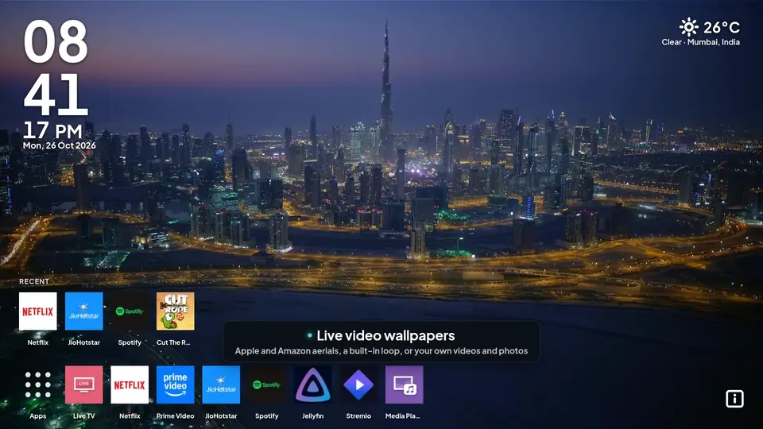

<p align="center">
  
</p>

<h1 align="center">OpenLauncher</h1>

<p align="center">
  <b>A custom home screen for webOS TVs</b><br>
  Live video wallpapers, folders, a settings screen with live previews, and full remote-control support.
</p>

<p align="center">
  <a href="https://github.com/Shantil-K/OpenLauncher/releases"></a>
  
  
  <a href="./LICENSE"></a>
</p>

<p align="center">
  <a href="https://github.com/Shantil-K/OpenLauncher/releases/download/v1.0.1/OpenLauncher-demo.mp4">
    
  </a><br>
  <a href="https://github.com/Shantil-K/OpenLauncher/releases/download/v1.0.1/OpenLauncher-demo.mp4"><b>▶ Watch the full demo (1:46)</b></a>
</p>

# Features

- **Video wallpaper** on the TV's hardware decoder: streamed aerials (Apple, Amazon, community), a built-in offline loop, a fixed picture, or your own links and photos.
- **App menu with folders**. HDMI inputs, TV settings, sharing and other system apps are sorted into folders of their own.
- **Edit mode**: hide, rename, reorder, move to folders, pin to the bottom bar or uninstall apps.
- **Clock, date and weather** anywhere on screen, in digital, stacked or analog styles.
- **Settings with live previews**, OLED protection (pixel shift, idle dimming), recent apps, and backup/restore.
- **Full remote support**: arrows, OK, Back, coloured buttons and the Magic Remote pointer.
- **Replace the stock Home screen** and **update from GitHub** right from the app (root).

Requires webOS 6 or newer. Tested on an LG C2.

# Install

1. Download the `.ipk` from [Releases](https://github.com/Shantil-K/OpenLauncher/releases).
2. Install it with [webOS Dev Manager](https://github.com/webosbrew/dev-manager-desktop) or `ares-install`.

It needs a rooted TV with [Homebrew Channel](https://github.com/webosbrew/webos-homebrew-channel), or `"trustLevel": "trusted"` in `appinfo.json` (developer-mode TVs usually don't allow that).

Everything else is set up inside the app. To make it your Home screen, open **Settings > TV > Replace stock Home** and press **Apply**. Before uninstalling, press **Restore stock Home**, or use **Settings > App info > Uninstall OpenLauncher**, which does both.

# Remote shortcuts

- **Yellow**: Settings · **Red**: Now playing card · **Blue**: Edit mode
- **Back** goes up one level. In Edit mode, **OK** on an app opens its menu.

Tip: if the video wallpaper looks grainy, use Game or Filmmaker picture mode, or turn off noise reduction.

# Build

```
$ ./scripts/make-wallpaper-video.sh   # optional: builds the offline wallpaper loop (needs ffmpeg)
$ ares-package src
```

To refresh the aerial video list, run `python3 main.py` and then `python3 make_js.py` inside `NetworkVideo/`.

# Credits

- Based on **QwQHome** by **exkc** ([git.exkc.moe/qvh/moe.exkc.hoooooooooom](https://git.exkc.moe/qvh/moe.exkc.hoooooooooom)). All credit for the original design and implementation goes to exkc.
- Uses [QwQwebosTV.js](https://git.exkc.moe/qvh/QwQwebosTV.js), also by exkc, vendored in `src/js/lib/QwQwebosTV.js/`.
- Aerial video list from [conreo/couchy-launcher](https://github.com/conreo/couchy-launcher). The videos are streamed from their original hosts.
- Weather by [Open-Meteo.com](https://open-meteo.com) ([CC BY 4.0](https://creativecommons.org/licenses/by/4.0/)).

# License

GPLv3 (see [LICENSE](./LICENSE)), except:

- `src/access/wallpaper/*`: CC-BY-SA
- `src/access/fallback.png`, `src/access/appbar.svg`: probably Apache 2.0 (from webOS OSS and Google Fonts)
- `src/js/icons.js`: Material Symbols by Google, Apache 2.0
- `src/access/plusjakartasans-bold.woff2`: Plus Jakarta Sans, SIL Open Font License (see `src/access/OFL-PlusJakartaSans.txt`)
- `src/js/lib/QwQwebosTV.js/main.js`: WTFNMFPL (see its SPDX header)
