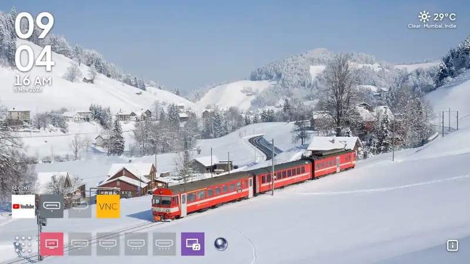

<p align="center">
  
</p>

<h1 align="center">OpenLauncher</h1>

<p align="center">
  <b>A custom home screen for webOS TVs</b><br>
  Video and photo wallpapers, folders, your own icons, a settings screen with live previews, and full remote-control support.
</p>

<p align="center">
  <a href="https://github.com/Shantil-K/OpenLauncher/actions/workflows/build.yml"></a>
  <a href="https://github.com/Shantil-K/OpenLauncher/releases"></a>
  
  
  
  <a href="./LICENSE"></a>
</p>

<p align="center">
  <a href="https://github.com/Shantil-K/OpenLauncher/releases/download/v3.0.0/OpenLauncher-demo.mp4">
    
  </a><br>
  <a href="https://github.com/Shantil-K/OpenLauncher/releases/download/v3.0.0/OpenLauncher-demo.mp4"><b>▶ Watch the demo (1:01)</b></a>
</p>

# Features

- **Wallpaper**: streamed aerial videos (Apple, Amazon, community) on the TV's hardware decoder, or **My wallpapers**: built-in photos, online photo albums (Landscapes, Mountains, Seas and lakes, Forests, Night skies, Cities: pick single photos or a whole album), your own pictures, videos and whole folders from a USB stick or the TV's storage, or links. One stays put; several take turns.
- **App menu with folders**. HDMI inputs, TV settings, sharing and other system apps are sorted into folders of their own. The menu lines up with the bottom bar and stops above the Recent row when everything fits.
- **Edit mode**: hide, reorder, move to folders, pin to the bottom bar or uninstall apps.
- **Your own names and icons** (Settings > Apps > Names and icons), with icons from a USB stick or the TV's storage.
- **Running apps**: see what the TV keeps open in the background and close one or all of them (green button).
- **Input status**: HDMI inputs with nothing plugged in are dimmed, and a connected device's name (like PlayStation 5) shows on its input.
- **Clock, date and weather** anywhere on screen, in digital, stacked or analog styles; 12 or 24 hours, or the same as the TV.
- **Your look**: sharp or rounded corners, square to circular app icons, row spacing, sizes, names and the hover colour.
- **Settings with live previews**, OLED protection (pixel shift, idle dimming), recent apps, and backup/restore.
- **Full remote support**: arrows, OK, Back, coloured buttons and the Magic Remote pointer.
- **Replace the stock Home screen**, **start the TV straight into OpenLauncher**, and **update from GitHub** with signed updates, right from the app (root).
- **Fast start**: the home screen is drawn from the app list saved last time, then refreshed in the background.

Requires webOS 6 or newer. Tested on an LG C2.

**webOS 5 [Beta]**: OpenLauncher now runs on webOS 5 as well (app icons, the app list and launching were fixed for it, and
all of its code runs on webOS 5's older browser). It hasn't been tried on a webOS 5 TV by the maintainer yet, and some
spacing between buttons can look tighter there. Please report how it works on yours in
[issue #2](https://github.com/Shantil-K/OpenLauncher/issues/2) or a new issue.

# Install

1. Download the `.ipk` from [Releases](https://github.com/Shantil-K/OpenLauncher/releases).
2. Install it with [webOS Dev Manager](https://github.com/webosbrew/dev-manager-desktop), Homebrew Channel or `ares-install`.

It needs a rooted TV with [Homebrew Channel](https://github.com/webosbrew/webos-homebrew-channel), or `"trustLevel": "trusted"` in `appinfo.json` (developer-mode TVs usually don't allow that).

Everything else is set up inside the app:

- **Make it your Home screen**: Settings > TV > Replace stock Home > **Apply**.
- **Open it when the TV turns on**: Settings > TV > When the TV turns on > **OpenLauncher** (works from the next full restart).
- **Your own wallpapers and icons**: put pictures and videos on a USB stick or in `/media/developer/wallpapers` (copy them over SSH or with Dev Manager's file manager).
- **Updates**: Settings > App info > **Check for updates**.
- **Uninstalling**: Settings > App info > **Uninstall OpenLauncher** puts LG's Home and start-up back first. Uninstalling another way leaves Home pointed at an app that's gone, so press **Restore stock Home** before that.

Without root, nothing can replace LG's Home: use the TV's Quick Access (hold a number key while OpenLauncher is open), or run [`tools/home-watch`](tools/home-watch) on another device that stays on.

# Remote shortcuts

- **Yellow**: Settings · **Red**: Now playing card · **Green**: Running apps · **Blue**: Edit mode
- **Back** goes up one level. In Edit mode, **OK** on an app opens its menu.

Tip: if the video wallpaper looks grainy, use Game or Filmmaker picture mode, or turn off noise reduction.

# Using it with Glasshouse

[Glasshouse](https://github.com/rorygallagher2024/glasshouse) is a dashboard that runs on a rooted TV: privacy and ad
controls, Home Assistant, OLED panel care, metrics and screen savers. It works alongside OpenLauncher; let each do its own
part:

| Let OpenLauncher do | Let Glasshouse do |
| --- | --- |
| The Home screen and the Home button (Settings > TV > Replace stock Home) | Privacy, ads and the ad blocker |
| What the TV opens when it turns on (Settings > TV > When the TV turns on) | Home Assistant, OLED care, metrics, screen savers |
| | Remapping the remote's other buttons |

In Glasshouse:

- **Leave "Use Glasshouse Home" off**, and **"Open Home at power-on"** and **"Hide LG's Home while the TV starts"** with it:
  they compete with OpenLauncher for the Home button and the start-up.
- **Don't remap the Home button** there. Other buttons are fine.
- **Its ad blocker is fine**: none of the servers OpenLauncher uses (GitHub, Open-Meteo, the video hosts, Wikimedia
  Commons) are on its lists.
- **"Hide home-screen system apps"** hides those apps for the whole TV, so they leave OpenLauncher's app menu too
  (Settings > Apps > System apps shows them again).
- **Switched-off background services**: keep the input service (`eim`) and the app manager's services on, or OpenLauncher's
  input status and app launching stop working.
- **Both close the web debugger** with the same firewall rule; they don't get in each other's way.
- **Its dashboard has no password by default**: set its token (see its Security page) and never forward port 8080 to the
  internet.

# Build

```
$ ares-package src
```

Every push to `main` and every pull request is checked and built by GitHub Actions
([Build](https://github.com/Shantil-K/OpenLauncher/actions/workflows/build.yml)); the `.ipk` of each run can be downloaded
from the run's page for 14 days, for trying a change on a TV.

To try it or record a demo without a TV, [`tools/simulator`](tools/simulator) runs the launcher in Chrome on a computer,
with your TV's apps and settings, the remote on the keyboard and the Magic Remote's pointer.

Releases (maintainers):

1. `scripts/set-version.sh X.Y.Z`, add `.github/release-notes/vX.Y.Z.md`, commit.
2. `git tag -a vX.Y.Z -m "OpenLauncher vX.Y.Z" && git push origin main vX.Y.Z`: the
   [Release](.github/workflows/release.yml) workflow builds it, records its build provenance and publishes it.
3. `scripts/sign-release.sh vX.Y.Z`: checks the provenance, signs the `.ipk` with the offline key and uploads the
   signature. Until then the in-app updater won't install it.

Lists made by scripts: the aerial videos (`python3 main.py`, then `python3 make_js.py`, inside `NetworkVideo/`) and the
online wallpaper albums (`python3 scripts/make-online-wallpapers.py`).

# Security

OpenLauncher can run commands as root on a rooted TV, so it is built to keep that power to itself:

- **Signed updates.** The in-app updater only installs a release whose `.ipk` is signed with the maintainer's key, which
  never leaves the maintainer's computer. The TV checks the signature (and GitHub's checksum) before installing, over
  HTTPS only. A release is also built with [GitHub build provenance](https://docs.github.com/actions/security-for-github-actions/using-artifact-attestations),
  which is checked before it is signed. To check a download yourself:
  `openssl dgst -sha256 -verify key.pem -signature com.homebrew.openlauncher_X_all.ipk.sig com.homebrew.openlauncher_X_all.ipk`
  with the public key from `src/js/update.js`.
- **No outside scripts.** A Content Security Policy lets only the launcher's own script files run, so an app name, a file
  name, a backup or a web answer can never run code. Everything sent to the root shell is quoted.
- **Web debugger off the network.** Developer Mode opens a debugger on port 9998 that anyone on the network could use to
  run code inside OpenLauncher. On rooted TVs a firewall rule keeps it to the TV itself (Settings > TV > Web debugger);
  developers can still reach it with `ssh -L 9998:localhost:9998 root@<TV>`.
- **Root files in root-only places.** Anything that runs as root at start-up, or is mounted into the system, lives in
  `/var/lib/webosbrew`, never in `/media/developer` or `/tmp`, where any app on the TV can write.

Found a problem? Please open an issue, or for anything serious, contact the maintainer privately first.

# Credits

- Based on **QwQHome** by **exkc** ([git.exkc.moe/qvh/moe.exkc.hoooooooooom](https://git.exkc.moe/qvh/moe.exkc.hoooooooooom)). All credit for the original design and implementation goes to exkc.
- Uses [QwQwebosTV.js](https://git.exkc.moe/qvh/QwQwebosTV.js), also by exkc, vendored in `src/js/lib/QwQwebosTV.js/`.
- Aerial video list from [conreo/couchy-launcher](https://github.com/conreo/couchy-launcher). The videos are streamed from their original hosts.
- Starting the TV into the launcher uses the method of [Hearth](https://github.com/rudra-avatar/Hearth) by rudra-avatar (MIT), which also inspired custom icons, running apps and the USB wallpapers.
- Input status, the TV's 12/24-hour clock and closing the web debugger to the network build on the research in
  [Glasshouse](https://github.com/rorygallagher2024/glasshouse) by Rory Gallagher (MIT).
- `tools/home-watch` is adapted from [webos-vibehack](https://github.com/OmkarK97/webos-vibehack) by Gathin and OmkarK97 (MIT, see [its license](tools/home-watch/LICENSE)).
- Online wallpaper albums: [Wikimedia Commons](https://commons.wikimedia.org) featured pictures, each by its author under
  its own free license (public domain, CC0, CC BY or CC BY-SA); the author and license of the photo on screen are shown in
  the Now playing card. The list is made by `scripts/make-online-wallpapers.py`.
- Weather by [Open-Meteo.com](https://open-meteo.com) ([CC BY 4.0](https://creativecommons.org/licenses/by/4.0/)).

# License

GPLv3 (see [LICENSE](./LICENSE)), except:

- `src/access/wallpaper/*`: CC-BY-SA
- `src/access/fallback.png`, `src/access/appbar.svg`: probably Apache 2.0 (from webOS OSS and Google Fonts)
- `src/js/icons.js`: Material Symbols by Google, Apache 2.0
- `src/access/plusjakartasans-bold.woff2`: Plus Jakarta Sans, SIL Open Font License (see `src/access/OFL-PlusJakartaSans.txt`)
- `src/js/lib/QwQwebosTV.js/main.js`: WTFNMFPL (see its SPDX header)
- `tools/home-watch/home-watch.py`, `tools/home-watch/lgtv.py`: MIT (see `tools/home-watch/LICENSE`)
- The online wallpaper photos aren't part of OpenLauncher: they are loaded from Wikimedia Commons, each under its own license
  (listed with its author in `src/js/onlinewallpapers.js` and shown in the Now playing card)
